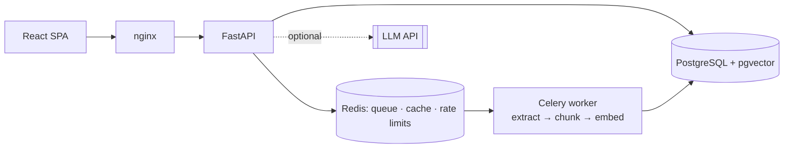

# DocuMind AI

**Ask questions about your PDFs and get answers with exact page citations.**
A full-stack Retrieval-Augmented Generation (RAG) platform: FastAPI · PostgreSQL + pgvector ·
Celery + Redis · Sentence Transformers · React + TypeScript · Docker.

   

## Features

- **Secure accounts** — Argon2id, short-lived JWT in memory + rotating refresh token (httpOnly cookie, reuse detection), **email verification and password reset**, role-based admin access, rate limits
- **Upload anything text-based** — drag & drop several files at once: **PDF, Word (.docx), text, Markdown**; scanned PDFs are read with **OCR** (Tesseract). Validated (type, magic bytes, size, zip bombs, corrupt, password-protected), streamed to storage
- **Background processing** — Celery workers extract text, chunk it page-aware, embed it locally into pgvector; **live status over SSE with "page 12 of 40" progress**, automatic retries
- **Grounded answers** — hybrid search (pgvector + full-text, RRF) and cross-encoder re-ranking over *your own* documents only; streamed answers cite **file + exact page + excerpt**, clickable into an in-app PDF viewer; says *"the documents do not contain enough information"* instead of guessing
- **Document insights** — an automatic **summary and suggested questions** for every document
- **Conversations** — history, follow-ups, **rename, full-text search, Markdown/JSON export**, stop / copy / regenerate / 👍👎
- **Trash and quotas** — deleted documents go to a restorable **trash** (purged after 30 days); **per-user quotas** for documents, storage and questions per day (admin overrides)
- **Works without an API key** — local extractive mode out of the box; plug in any OpenAI-compatible LLM (OpenAI, Groq, Ollama) via `.env`
- **Fast** — exact **and semantic** answer cache (paraphrased questions reuse answers, with number/negation guards), query-embedding cache, versioned invalidation
- **Observable** — **Prometheus `/metrics` + a provisioned Grafana dashboard** (latency per route, RAG stage timings, cache hit ratios, queue, workers); **Locust load test**
- **Admin** — users, quotas, processing statistics, failed-task monitoring and retry, system metrics
- **Production-minded** — strict per-user isolation, security headers, safe error responses, health checks, one-command Docker deployment, CI

## Architecture



RAG flow: *question → (rewrite follow-up) → embed → cosine search filtered by user →
threshold → numbered context → LLM or extractive answer → citations validated against the database.*

| Document | Contents |
|---|---|
| [docs/architecture.md](docs/architecture.md) | Layers, request sequence diagrams, design decisions, scaling |
| [docs/database-design.md](docs/database-design.md) | ER diagram, relationships, indexes, HNSW |
| [docs/rag-pipeline.md](docs/rag-pipeline.md) | Retrieval, hallucination controls, citations, score calibration |
| [docs/api-documentation.md](docs/api-documentation.md) | Every endpoint with sample requests/responses and error codes |
| [docs/deployment.md](docs/deployment.md) | Docker architecture, configuration, production checklist, cloud options |
| [docs/security.md](docs/security.md) | Security controls, audit results, known trade-offs |
| [docs/testing.md](docs/testing.md) | Test strategy, requirement → test map, bugs the tests caught |
| [docs/load-testing.md](docs/load-testing.md) | Locust load test: how to run it, results, what limits throughput |
| [docs/interview-prep.md](docs/interview-prep.md) | Project pitch, core Q&As, system-design walkthrough |

## Quick start (Docker — recommended)

Prerequisite: Docker Desktop.

```powershell
copy .env.example .env
python -c "import secrets; print(secrets.token_urlsafe(64))"   # put this into JWT_SECRET_KEY in .env
docker compose up -d --build
```

Open **http://localhost:8080** → register → upload a document → ask a question.
Emails (verification, password reset) are caught by Mailpit: **http://localhost:8025**.
Monitoring: `docker compose --profile monitoring up -d` → Grafana **http://localhost:3000**, Prometheus **http://localhost:9090**.
Details and production checklist: [docs/deployment.md](docs/deployment.md).

## Local development

Prerequisites: Python 3.13, Node 20.19+, Docker Desktop (for PostgreSQL + Redis).

```powershell
# backend
python -m venv .venv; .\.venv\Scripts\Activate.ps1
pip install -r requirements-dev.txt
copy .env.example .env                       # set JWT_SECRET_KEY
docker compose up -d postgres redis
alembic upgrade head
uvicorn app.main:app --reload                # API on http://127.0.0.1:8000 (Swagger: /docs)
celery -A app.tasks.celery_app worker --pool=solo -l info   # 2nd terminal (Windows needs --pool=solo)
celery -A app.tasks.celery_app beat -l info                 # optional 3rd terminal (sweeper)

# frontend (4th terminal)
cd frontend; npm install; npm run dev        # http://127.0.0.1:5173
```

Create an admin: `python -m scripts.create_admin --email you@example.com`.

## Testing

```powershell
pytest                          # 307 tests against real PostgreSQL/pgvector (~2 min)
pytest -m "not model"           # skip tests that load the real embedding model (~1 min)
pytest --cov=app                # coverage (97 % of application code)
python -m scripts.e2e_frontend  # browser end-to-end test (Playwright; full stack running)
python -m scripts.benchmark --email … --password …   # latency percentiles
```

CI (GitHub Actions) runs migrations, the full suite with a 90 % coverage gate, and the frontend build on every push.

## Tech stack

| Layer | Technology |
|---|---|
| API | FastAPI, Pydantic v2, Uvicorn |
| Database | PostgreSQL 16, pgvector 0.8 (HNSW, cosine), SQLAlchemy 2.0, Alembic |
| PDF | PyMuPDF (optional Tesseract OCR) |
| AI | Sentence Transformers `all-MiniLM-L6-v2` (384-d, local CPU), OpenAI-compatible LLM (optional) |
| Background jobs | Celery 5, Redis 7 (broker, cache, rate limiting) |
| Security | JWT (PyJWT), Argon2id, RBAC, rate limiting, security headers |
| Frontend | React 18, TypeScript, Vite 8, Tailwind CSS, React Router 7 |
| Testing | Pytest, FastAPI TestClient, fakeredis, Playwright, pytest-cov |
| Ops | Docker, Docker Compose, nginx, GitHub Actions |

## Configuration

All settings come from environment variables / `.env` — see [.env.example](.env.example).
Most important: `JWT_SECRET_KEY` (required), `POSTGRES_PASSWORD`, `OPENAI_API_KEY`
(optional), `ENVIRONMENT=production` (enables startup safety checks).

## Performance (local laptop, CPU)

| Request | p50 | p95 |
|---|---|---|
| `GET /documents` | ~21 ms | ~31 ms |
| `POST /chat/ask` (full RAG, extractive) | ~310 ms | ~430 ms |
| `POST /chat/ask` (answer cache hit) | ~40 ms | ~45 ms |

Load test (Locust, 20 users, 5 min, everything on one laptop): 2,156 requests, 0 failures,
`/chat/ask` p50 350 ms, 35 % answered from cache. It also found and fixed a connection-pool
exhaustion under concurrent logins — see [docs/load-testing.md](docs/load-testing.md).

## Known limitations

- Extractive mode (no LLM key) quotes sentences rather than writing a fluent answer and may include a closely related extra sentence.
- OCR is on in Docker (Tesseract, English); a local non-Docker setup needs Tesseract installed and `OCR_ENABLED=true`. OCR is slow (~1–3 s per scanned page).
- Pages of DOCX/TXT/Markdown files are the pages of the PDF they are converted to (shown in the viewer), not Word's own page breaks.
- An access token stays valid for up to 15 minutes after logout or a password reset (refresh tokens are revoked immediately).
- The semantic cache is deliberately conservative (similarity ≥ 0.95 + same numbers/negations), so many paraphrases still get a fresh answer.
- One embedding model process handles queries serially; scale with more API replicas or a GPU.
- Uploads use local/volume storage; production should use object storage (S3).

## Future improvements

S3 storage with presigned URLs · RAG evaluation (faithfulness / recall@k) in CI ·
multi-tenant teams and sharing · OCR languages per document · alerting rules
(Alertmanager) · Kubernetes manifests · CI/CD with cloud deployment.

## Project status

- [x] **Phase 1** – FastAPI foundation, config, logging, error handling, health checks
- [x] **Phase 2** – PostgreSQL, SQLAlchemy models, pgvector, Alembic, ER diagram
- [x] **Phase 3** – Authentication (JWT, Argon2, RBAC), admin CLI
- [x] **Phase 4** – PDF upload, validation, secure storage, PyMuPDF extraction
- [x] **Phase 5** – Page-aware chunking with overlap, idempotent pipeline
- [x] **Phase 6** – Local embeddings in pgvector, batching, reuse, semantic search
- [x] **Phase 7** – Celery + Redis processing, retries, crash recovery, sweeper, admin monitoring
- [x] **Phase 8** – RAG engine: calibrated retrieval, LLM + extractive fallback, exact page citations
- [x] **Phase 9** – Chat & conversation API with follow-ups and document selection
- [x] **Phase 10** – Redis caching, rate limiting, timing middleware, metrics, benchmark
- [x] **Phase 11** – React + TypeScript frontend, browser E2E test
- [x] **Phase 12** – 307 tests, 97 % coverage, CI
- [x] **Phase 13** – Security audit and hardening (0 known vulnerabilities)
- [x] **Phase 14** – Docker images, full Docker Compose deployment
- [x] **Phase 15** – Documentation and interview preparation

Improvements after the 15 phases: hybrid search + re-ranking + evaluation set · streaming
answers · rotating refresh tokens · clickable citations with PDF viewer · stop/copy/regenerate/
feedback · live processing status (SSE) · DOCX/TXT/Markdown + OCR · conversation rename/search/
export · document summaries · email verification + password reset · Prometheus + Grafana ·
trash + quotas · semantic cache · Locust load test.
