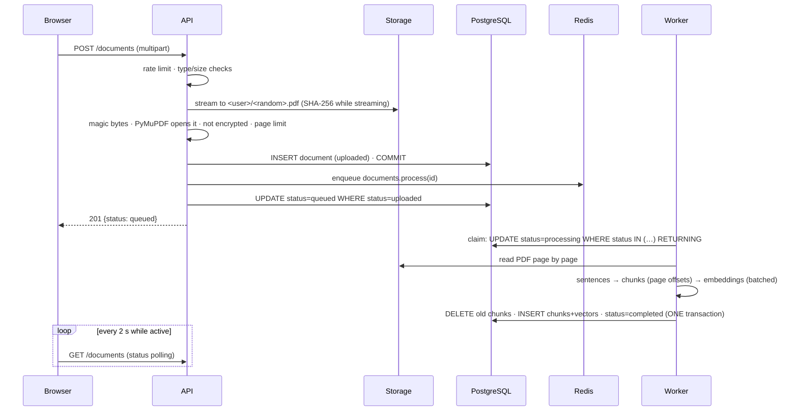
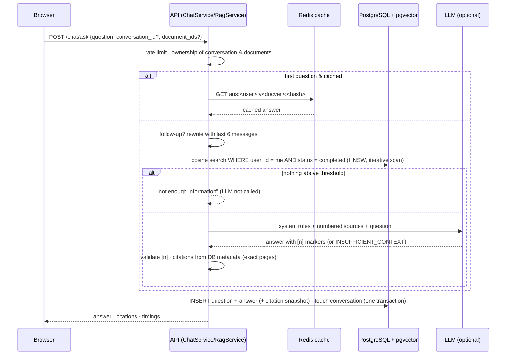

# Architecture

## System overview

```mermaid
flowchart TB
    subgraph Client
        UI[React + TypeScript SPA<br/>Vite · Tailwind]
    end
    subgraph Edge
        NG[nginx<br/>static files · /api proxy · security headers]
    end
    subgraph API["FastAPI (stateless, horizontally scalable)"]
        MW[Middleware<br/>request id · timing · security headers · body limit]
        R[Routers<br/>auth · documents · chat · conversations · admin · health]
        S[Services<br/>auth · document · pdf · chunking · embedding<br/>retrieval · rag · chat · cache · storage]
        RP[Repositories<br/>user · document · conversation]
    end
    subgraph Workers
        W[Celery worker<br/>extract → chunk → embed → store]
        B[Celery beat<br/>sweeper]
    end
    subgraph Data
        PG[(PostgreSQL 16 + pgvector<br/>users · documents · chunks + VECTOR(384) · conversations · messages)]
        RD[(Redis<br/>broker · answer/embedding cache · rate limits · metrics)]
        FS[(Upload storage<br/>local volume → S3 in production)]
    end
    LLM[[LLM API — optional<br/>OpenAI-compatible]]
    EMB[[Embedding model<br/>all-MiniLM-L6-v2, local CPU]]

    UI --> NG --> MW --> R --> S --> RP --> PG
    S --> RD
    S --> FS
    S -. enqueue .-> RD
    RD -. job .-> W
    B -. re-enqueue .-> RD
    W --> FS
    W --> EMB
    W --> PG
    S --> EMB
    S -.-> LLM
```

## Layers (backend)

| Layer | Responsibility | Rule |
|---|---|---|
| **Routers** (`app/routers`) | HTTP: parse/validate input (Pydantic), call a service, return a schema | No business logic, no SQL |
| **Services** (`app/services`) | Business logic: upload pipeline, processing, RAG, chat, caching | No HTTP objects; raise `AppError` subclasses |
| **Repositories** (`app/repositories`) | All SQL for a table; **every read takes `user_id`** | The only place queries are written |
| **Models / Schemas** | SQLAlchemy tables / Pydantic API contracts | Separate input and output schemas (no password hash can leak) |
| **Core** (`app/core`) | Config, security, dependencies, errors, rate limiting, middleware | Cross-cutting concerns in one place |
| **Tasks** (`app/tasks`) | Celery app + tasks (thin wrappers around services) | Same services as the API → one code path |

Dependency injection (`Depends`) supplies DB sessions, the current user, the
storage backend, the task queue, the embedder and the LLM client — which is
also how tests replace them with fakes.

## Request flows

### Upload → processing



### Question → answer



## Key design decisions

| Decision | Alternatives | Why |
|---|---|---|
| **pgvector in PostgreSQL** | Pinecone, Qdrant, Weaviate | One database: ACID transactions across chunks + metadata, `user_id` filter and vector search in one SQL query, no data sync, simpler ops. Dedicated vector DBs win at very large scale. |
| **Local embedding model** | OpenAI embeddings API | Free, private (documents never leave the server), no rate limits, works offline. Trade-off: CPU latency, quality below the best hosted models. |
| **Celery + Redis for processing** | FastAPI `BackgroundTasks`, threads | Survives API restarts, retries with backoff, `acks_late` re-delivery after crashes, scales independently of the API. |
| **Sync SQLAlchemy + `def` endpoints** | async SQLAlchemy | One session style shared with Celery; CPU-bound work (Argon2, embeddings) runs in the thread pool and never blocks the event loop. |
| **Atomic claim + single-transaction write** | Locks held for the whole job | Duplicate deliveries are harmless; no long-held row locks; crash → full rollback, never half the chunks. |
| **Citations from DB, never from LLM text** | Ask the LLM for page numbers | Page numbers cannot be hallucinated. |
| **Page offsets per chunk** | Page number per chunk | Exact page of each quoted sentence, even when a chunk spans pages. |
| **Versioned cache invalidation** | Delete keys on change | O(1) invalidation, no key scanning, no race conditions. |
| **Fail-open Redis features** | Fail-closed | Cache and rate limiting are optimisations/protection; an outage must not take the product down. |
| **UUID primary keys** | Auto-increment integers | Not enumerable; generated anywhere. |

## Scaling to 10,000 concurrent users

| Bottleneck | Approach |
|---|---|
| API CPU (query embedding) | More API replicas (stateless); `uvicorn --workers N`; GPU or hosted embedding API; the query-embedding and answer caches remove repeated work |
| LLM latency / cost | Answer cache; smaller/faster models; streaming responses; per-user rate limits |
| Processing backlog | More Celery workers (autoscale on queue length); separate queue for large PDFs |
| Vector search | HNSW index (already); tune `ef_search`; partition `document_chunks` by `user_id` hash; read replicas |
| PostgreSQL connections | PgBouncer in front; pool size per replica |
| Redis | Managed Redis with replication; separate instances for broker and cache |
| File storage | S3 + presigned URLs; workers read directly from S3 |
