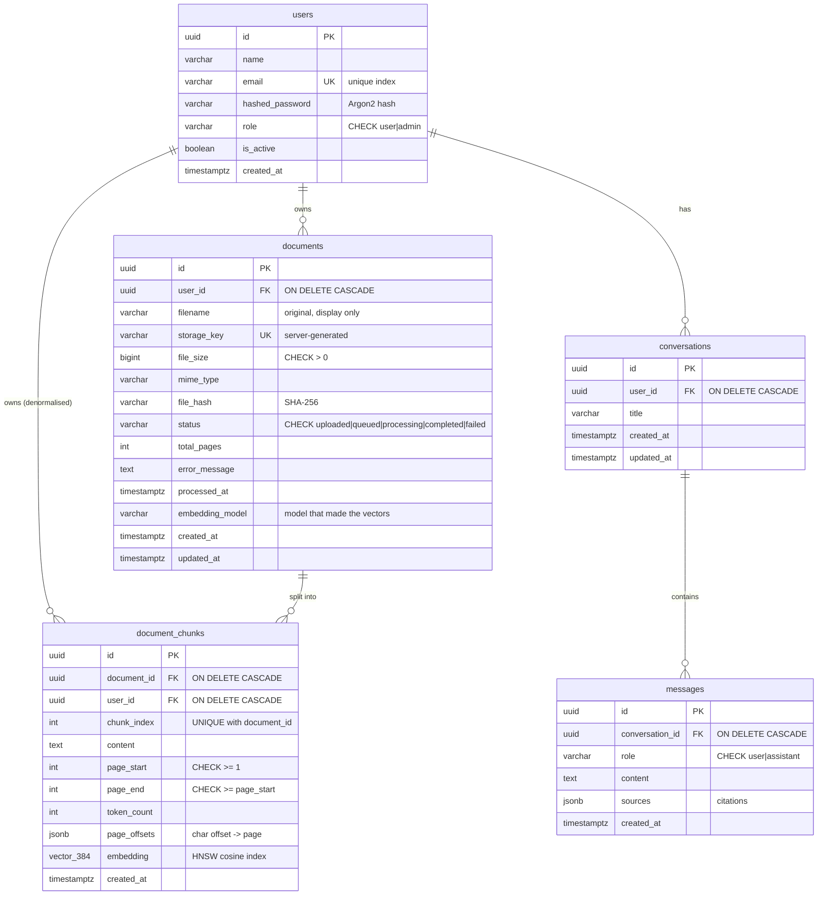

# Database Design

PostgreSQL 16 + pgvector 0.8. ORM: SQLAlchemy 2.0. Migrations: Alembic.

## ER Diagram



## Relationships

| Relationship | Type | On delete | Why |
|---|---|---|---|
| users → documents | 1 : N | CASCADE | A user owns many PDFs; deleting an account removes their documents. |
| documents → document_chunks | 1 : N | CASCADE | A PDF is split into many chunks; chunks are meaningless without their document. |
| users → document_chunks | 1 : N | CASCADE | **Denormalised** owner column so vector search can filter `WHERE user_id = :me` without a JOIN. This is the data-isolation boundary for RAG. |
| users → conversations | 1 : N | CASCADE | Chat history belongs to one user. |
| conversations → messages | 1 : N | CASCADE | A conversation is an ordered list of messages. |

Cascades are enforced **in PostgreSQL** (`ON DELETE CASCADE`), not only in the ORM.
SQLAlchemy relationships use `passive_deletes=True`, so deleting a document with
10,000 chunks is one `DELETE` statement, not 10,000 loaded objects.

## Design Decisions

| Decision | Reason |
|---|---|
| UUID primary keys | Not guessable (`/documents/42` → `/43` enumeration attacks); can be generated by API or worker without a DB round-trip. |
| `page_start` / `page_end` instead of one `page_number` | A chunk can cross a page boundary. Storing a range keeps citations truthful ("pages 3–4"). |
| `UNIQUE (document_id, chunk_index)` | Makes background processing idempotent: a retried task cannot insert duplicate chunks. |
| Enums as `VARCHAR` + `CHECK` | Invalid values are rejected by the DB itself, and adding a new status is a simple constraint change (native PG `ENUM` needs `ALTER TYPE`). |
| `storage_key` separate from `filename` | User-supplied filenames are never used as file paths (prevents path traversal). |
| `file_hash` | Detect the same user uploading the same PDF twice. |
| `sources` as JSONB | Citations are always read together with their message; a separate table would add JOINs with no query benefit. |
| `error_message` on documents | Admin dashboard can show why processing failed. |
| `page_offsets` JSONB on chunks (migration `546fea95f2d8`) | `[[char_offset, page], …]` so a citation can name the exact page of a single sentence inside a multi-page chunk. |
| `embedding_model` on documents (migration `b241e1d090c8`) | Vectors from different models are not comparable; search and embedding reuse only combine vectors from the same model, and a model change can be detected and backfilled. |
| Timezone-aware timestamps (`timestamptz`) | Avoids bugs when servers/users are in different time zones. |
| Naming convention on `MetaData` | Every constraint has a predictable name so future Alembic migrations can alter/drop them. |

## Indexes

| Index | Serves query |
|---|---|
| `ix_users_email` (unique) | Login lookup by email; prevents duplicate accounts. |
| `ix_documents_user_id_created_at` | "My documents, newest first" — filter + sort from one index. |
| `ix_documents_status` | Admin: count/list failed or queued documents. |
| `ix_documents_user_id_file_hash` | Duplicate upload detection. |
| `uq_document_chunks_document_id_chunk_index` | Idempotency + "all chunks of document X in order". |
| `ix_document_chunks_user_id` | Restrict retrieval to the current user's chunks. |
| `ix_document_chunks_embedding_hnsw` | Approximate nearest-neighbour search on cosine distance (`<=>`). |
| `ix_conversations_user_id_updated_at` | Conversation sidebar, most recent first. |
| `ix_messages_conversation_id_created_at` | Load a conversation's messages chronologically. |

### Why HNSW?

Without an index, similarity search computes the distance to **every** vector
(exact, O(N)). HNSW (Hierarchical Navigable Small World) builds a layered graph
of neighbours so a query visits only a small fraction of vectors — approximate
but very fast. Parameters: `m = 16` (links per node), `ef_construction = 64`
(build-time search width). Query-time recall is tuned with `SET hnsw.ef_search`.

The alternative, IVFFlat, builds faster and uses less memory, but needs data
present before index creation and generally has lower recall.

## Embedding dimension

`all-MiniLM-L6-v2` produces 384-dimensional vectors → `VECTOR(384)`. The size is
configured by `EMBEDDING_DIMENSION`, but it is **baked into the column**:
switching to a model with a different dimension requires a new migration and
re-embedding all chunks.

## Commands

```powershell
docker compose up -d                 # start PostgreSQL + Redis
alembic upgrade head                 # apply migrations
alembic downgrade -1                 # undo the last migration
alembic revision --autogenerate -m "describe change"   # new migration from model changes
alembic current                      # show applied revision
python -m scripts.check_db           # verify connection, pgvector, tables
```
