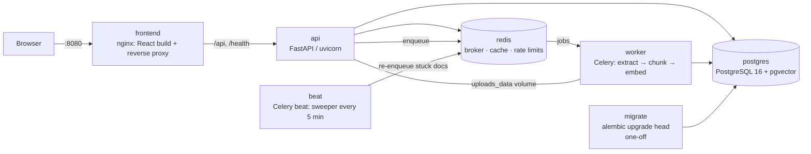

# Deployment

## Container architecture



| Service | Image | Purpose | Health check | Restart |
|---|---|---|---|---|
| `postgres` | `pgvector/pgvector:pg16` | Relational data + vectors | `pg_isready` | unless-stopped |
| `redis` | `redis:7-alpine` (AOF on) | Celery broker, cache, rate limits | `redis-cli ping` | unless-stopped |
| `migrate` | `documind-backend` | `alembic upgrade head`, then exits | – | no |
| `api` | `documind-backend` | FastAPI (non-root, model baked in) | `GET /health/ready` (DB + Redis) | unless-stopped |
| `worker` | `documind-backend` | Celery document processing | `celery inspect ping` | unless-stopped |
| `beat` | `documind-backend` | Periodic sweeper for stuck documents | – | unless-stopped |
| `frontend` | `documind-frontend` | nginx: static React app + `/api` proxy | `wget /` | unless-stopped |

Start order is enforced with `depends_on` conditions:
`postgres, redis (healthy)` → `migrate (completed)` → `api, worker, beat` → `api (healthy)` → `frontend`.

Volumes: `postgres_data` (database), `redis_data` (queue persistence),
`uploads_data` (PDFs, shared by `api` and `worker`).

## Run locally with Docker

Prerequisites: Docker Desktop (4 GB RAM is enough with the defaults).

```powershell
copy .env.example .env      # then set JWT_SECRET_KEY (see below)
python -c "import secrets; print(secrets.token_urlsafe(64))"   # paste into JWT_SECRET_KEY
docker compose up -d --build
docker compose ps           # wait until api/frontend are "healthy"
```

Open **http://localhost:8080**, register, upload a PDF, ask questions.

Create an admin (for `/api/v1/admin/*`):

```powershell
docker compose exec api python -m scripts.create_admin --email admin@example.com --name "Admin"
```

Useful commands:

```powershell
docker compose logs -f api worker          # follow logs
docker compose exec postgres psql -U documind -d documind
docker compose up -d --build api worker    # redeploy after code changes
docker compose down                        # stop (data kept)
docker compose down -v                     # stop and DELETE all data
```

## Configuration

Set in `.env` (Compose reads it automatically). See `.env.example` for all options.

| Variable | Default | Notes |
|---|---|---|
| `JWT_SECRET_KEY` | **required** | ≥ 32 random characters |
| `POSTGRES_PASSWORD` | dev password | **Change for any shared/production deployment** (startup refuses the dev password when `ENVIRONMENT=production`) |
| `ENVIRONMENT` | `development` | `production` enables startup safety checks and hides `/docs` |
| `OPENAI_API_KEY` / `OPENAI_BASE_URL` / `OPENAI_MODEL` | empty | Enable LLM answers; without a key, answers are extractive |
| `WORKER_CONCURRENCY` | `1` | Each worker process loads the model (~0.7 GB RAM) |
| `FRONTEND_PORT` | `8080` | Public port |
| `HSTS_ENABLED` | `false` | Set `true` only behind HTTPS |

## Image details

- **Backend:** `python:3.13-slim`, CPU-only PyTorch (avoids ~2 GB of CUDA libraries),
  embedding model downloaded **at build time** into `/models` (`HF_HUB_OFFLINE=1`
  at runtime → no network needed, identical model everywhere), runs as uid 10001,
  only `/app/storage` writable. One image for api / worker / beat / migrate.
- **Frontend:** multi-stage — Node 22 builds the bundle, the final image is
  nginx + static files only (no Node). nginx adds CSP and security headers,
  long-term caching for fingerprinted assets, SPA fallback, 25 MB upload limit,
  and forwards the client IP (`X-Forwarded-For`) for rate limiting.
- Postgres/Redis/API ports are bound to `127.0.0.1` — only nginx is public.

## Production checklist

1. `ENVIRONMENT=production`, strong `POSTGRES_PASSWORD` and `JWT_SECRET_KEY` (the app refuses to start otherwise).
2. TLS in front (load balancer, Caddy, Traefik or nginx with certificates), then `HSTS_ENABLED=true`.
3. Use managed PostgreSQL (with pgvector) and Redis, automated backups, and store uploads in object storage (S3/GCS) — `LocalStorage` has the same small interface an S3 class would implement.
4. Scale: more `api` replicas behind the load balancer (stateless: JWT + DB + Redis), more `worker` replicas for processing throughput; each process holds its own model copy.
5. Monitoring: `/health/ready` for the load balancer, `/api/v1/admin/metrics` for dashboards, ship logs (they contain request IDs, never personal data).
6. Run `bandit`, `pip-audit` and `npm audit` in CI before each release.

## Cloud options

| Option | How |
|---|---|
| Single VM (simplest) | Install Docker, copy the repo + `.env`, `docker compose up -d --build`, put Caddy in front for automatic HTTPS |
| Render / Railway / Fly.io | Deploy the backend image three times (api, worker, beat commands) + frontend image; use their managed PostgreSQL (pgvector enabled) and Redis |
| AWS | ECS Fargate services (api, worker, beat, frontend) · RDS PostgreSQL with pgvector · ElastiCache Redis · S3 for uploads · ALB with ACM certificate |
