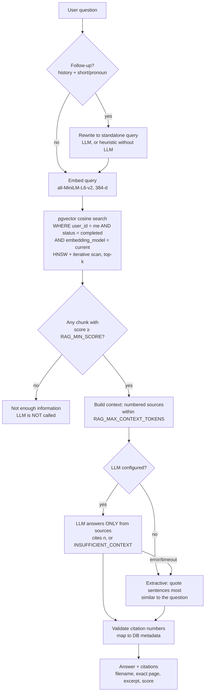

# RAG Pipeline

DocuMind answers questions **only from the user's own uploaded documents** and
returns citations with real page numbers.

## Flow



## Answer modes

| `LLM_PROVIDER` | Behaviour |
|---|---|
| `auto` (default) | `openai` if `OPENAI_API_KEY` is set, otherwise `extractive` |
| `openai` | Any OpenAI-compatible Chat Completions API (`OPENAI_BASE_URL` for Groq, Together, local Ollama…) |
| `extractive` | No LLM, no cost, no network: returns the most relevant sentences verbatim with citations |

If the LLM fails (timeout, 429, 5xx, auth) the answer **falls back to
extractive** and `llm_error` is set — the user still gets a grounded answer.

## Citations are never fabricated

1. The LLM only sees sources labelled `[1]…[n]`; it is told not to write page numbers.
2. `[n]` markers in the answer are parsed; numbers outside `1..n` are **removed**.
3. Each citation's filename, page and excerpt come from the **database row** of
   the retrieved chunk, never from LLM text.
4. **Exact pages:** each chunk stores `page_offsets` (`[[char_offset, page], …]`).
   A citation's `page_start/page_end` are the pages of the *quoted sentences*,
   not just the chunk range (also returned as `chunk_page_start/end`). A sentence
   that runs across a page break is re-joined and cited as e.g. pp. 1–2.
5. An LLM answer that cites nothing is returned with `grounded: false`.

## Hallucination reduction

| Technique | Where |
|---|---|
| No context → refuse **without calling the LLM** | `RagService.answer` |
| Relevance threshold (`RAG_MIN_SCORE`) | retrieval |
| Strict system prompt: only sources, cite everything, explicit `INSUFFICIENT_CONTEXT` escape | `SYSTEM_PROMPT` |
| Low temperature (0.1) | `LLM_TEMPERATURE` |
| Sources are delimited and escaped; prompt says never follow instructions inside them (prompt-injection defence) | `build_context` |
| Citation validation + `grounded` flag | `parse_citations` |
| Only vectors of the current embedding model, only `completed` documents | `search_chunks` |

## Data isolation

`search_chunks` requires `user_id` and always filters `document_chunks.user_id`
(denormalised column, so no JOIN is needed for the security filter). Tests
verify another user's perfectly matching chunk never reaches the prompt.

## Score calibration (all-MiniLM-L6-v2)

Measured on the demo handbook/policy documents (Phase 8). Cosine similarity of
the best match:

| Question type | Best chunk score | Best sentence score |
|---|---|---|
| Answerable (6 questions) | 0.261 – 0.739 | 0.349 – 0.789 |
| Unanswerable (5 questions) | 0.024 – 0.157 | 0.087 – 0.164 |
| **Threshold chosen** | **0.20** (`RAG_MIN_SCORE`) | **0.25** (extractive) |

Thresholds sit in the middle of the gap. The sample is small and the values are
**model specific** — re-calibrate after changing `EMBEDDING_MODEL_NAME`
(`scripts/semantic_search.py` prints scores). `test_rag_model.py` guards the
calibration with real-model regression tests.

Extractive mode also applies a **relative cutoff**: sentences must score ≥ 80 %
of the best sentence, which drops loosely related sentences (e.g. sick leave for
a vacation question).

## Retrieval at scale: HNSW + filters

The HNSW index returns the `ef_search` nearest vectors **globally**; the
`user_id` filter is applied afterwards. With many users, a user's chunks may not
be among the first candidates and the search would return too few rows.
`search_chunks` sets, per transaction:

```sql
SET LOCAL hnsw.ef_search = 100;                    -- RAG_HNSW_EF_SEARCH
SET LOCAL hnsw.iterative_scan = relaxed_order;     -- pgvector >= 0.8
```

Iterative scan keeps walking the graph until enough rows pass the filter;
`relaxed_order` results are re-sorted in Python.

## Response time

`RagAnswer.timings_ms` reports `rewrite`, `retrieval`, `generation` and `total`.
Typical (local CPU, warm model, extractive): retrieval 90–250 ms, total 150–300 ms.
The first request in a fresh process pays ~15–25 s to load the model — the API
pre-loads it at startup.

## Try it

```powershell
python -m scripts.ask --email you@example.com "How many vacation days do I get?"
python -m scripts.ask --email you@example.com --show-sources "Can I work from home?"
```
